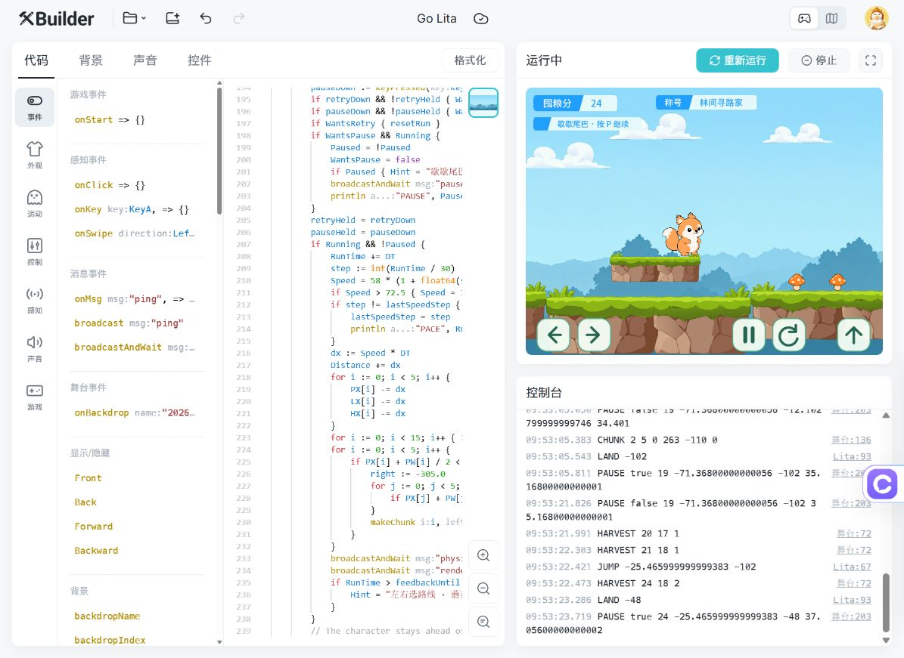
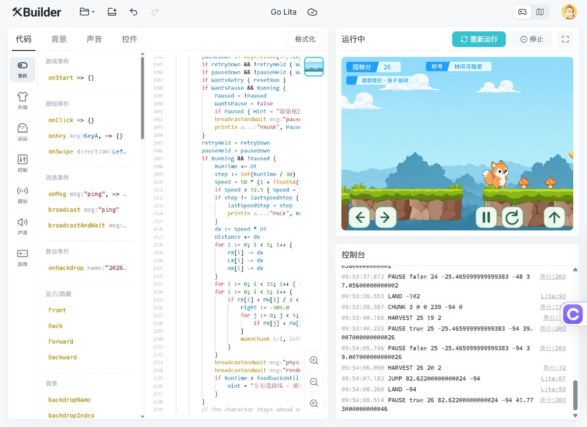
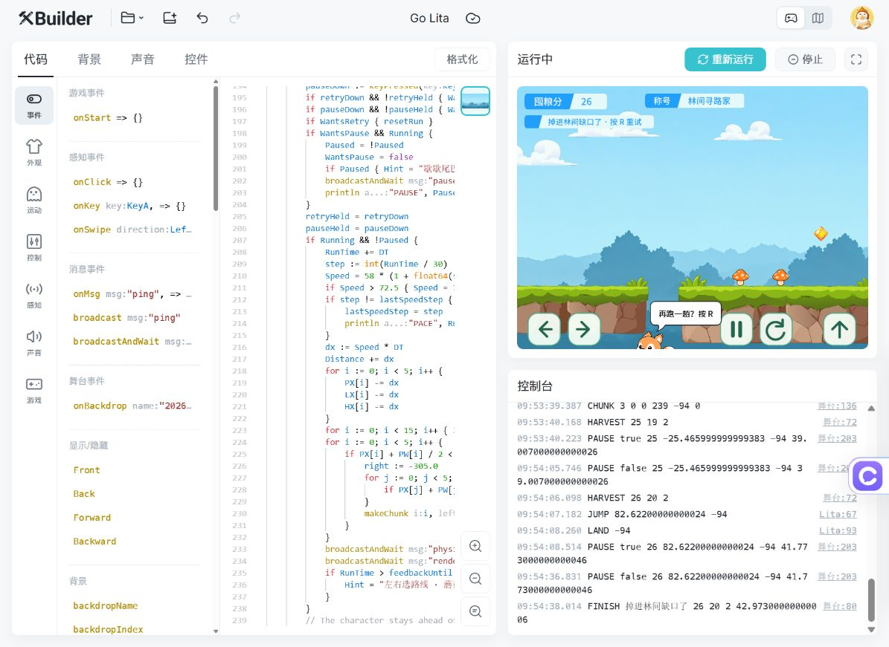

# Go Lita v0.2 验收记录

日期：2026-10-25。环境：已登录账号 En 的 XBuilder / IdeaDash，SPX 3.3.0 浏览器预览，480 × 360。测试使用真实键盘/鼠标输入和页面控制台；未发布游戏。

## 实际预览验证

| 检查项 | 结果与证据 |
|---|---|
| XGo/SPX 编译 | 多次运行通过，最终提示文案修订后再次编译运行 |
| 左右移动与转向 | 右键按住约 0.7 秒，X 从 -145 到 -62.4；A 键向左后 X 为 -130.84，朝向同步改变；屏幕左右按钮也能移动 |
| 单次跳跃与落地 | 长按空格 1.8 秒，控制台只有一次 JUMP、一次 LAND；落地脚底回到 -102，无自动连跳 |
| 蘑菇奖励 | 多次连续 HARVEST 的分数和蘑菇数均只递增 1，领取后消失 |
| 水晶奖励 | HARVEST 从 `16 16 0` 到 `19 16 1`，水晶只增加 1 个，分数增加 3 |
| 公式一致 | 本局结束日志 `FINISH 掉进林间缺口了 26 20 2 ...`，即 20 + 2 × 3 = 26 |
| 不按时间计分 | 无收集的移动/跳跃区间，分数保持 8；空中继续下落落地，分数保持 19；源码没有时间或距离加分入口 |
| 暂停 | 暂停/恢复日志中的分数、角色坐标、RunTime 一致；空中暂停后恢复仍继续下落并落地 |
| 屏幕短按 | 快速点击暂停按钮后出现 PAUSE false，再按 P 出现 PAUSE true；背景点击转发与按钮自己的按压检测共同处理输入 |
| 屏幕跳跃 | 点击向上箭头产生 JUMP，并在该次跳跃中收集草台水晶 |
| 草台落地 | 从主路 -102 起跳，随后 LAND -48，角色停在悬浮草台上；见下图 |
| 主路衔接 | 高低主路实测脚底从 -110 到 -94 后仍能站稳；补上了最多 16 像素的相邻小台阶处理 |
| 缺口通过 | 在可见短缺口前起跳，日志 JUMP ... -94 后 LAND -94，落在缺口右边，分数仍为 26 |
| 无支撑下落 | 随后向左走回同一缺口，约 1.2 秒后 FINISH 掉进林间缺口了，角色在屏幕下沿；无隐形地板 |
| 角色层级 | 草台下方移动与草台上落地时角色均保持前层；没有被平台盖住 |
| 危险结束 | 火焰触发 FINISH 碰到小火苗了；石头触发 FINISH 被小石头绊住了；结束后分数停止变化 |
| 树桩资源 | 素材库资源 293 已导入，生成日志出现危险类型 3，使用树桩自身脚本和独立校准碰撞；本轮未单独录到树桩命中结局 |
| 重试 | R 与屏幕回转箭头均可重开，START 序号增加，分数回到 0，角色回到 -145 / -102；多次重开后仍正常收集 |
| 随机路段 | 实测日志覆盖 0–5 模板、不同平台宽度、-110/-102/-94 高度、悬浮草台和约 39/41 像素缺口 |
| 缓慢加速 | RunTime 30.033 秒时 PACE 60.32，等于 58 × 1.04；之后分数仍只因 HARVEST 改变 |
| 循环回收 | 一局运行至约 43 秒，多个槽位循环 CHUNK；重试销毁旧克隆。固定池上限由源码检查确认，未进行内存仪表长测 |
| 云端持久化 | 重新加载同一 En/IdeaDash URL 后，Go Lita 显示名、22 个精灵、新版脚本仍在，重新运行成功 |

## 工程与资源检查

完整云端导出包包含 95 个文件、22 个精灵及舞台脚本。`project/` 解包后与 `.xbp` 每个文件逐字节一致。检查覆盖：

- 所有背景、造型、声音路径存在，路径保持在工程目录内。
- 动画首尾帧都能在对应造型表中找到。
- 精灵 ID 无重复，精灵顺序和图层引用与实际资源一致。
- 压缩包无损坏项、重复项或多余/缺失文件。
- Unity 参考成品包未执行，未加入本次提交。

执行方式：`python game/tools/package_project.py --check`。该命令不负责 SPX 编译；上表的游戏行为由 XBuilder 预览验证。

## 画面记录

18 个蘑菇、2 颗水晶达到 24 分，称号升级；角色站在草台上：

单跳通过缺口后，Lita 站在右侧草地：

走回缺口后失去支撑，下落结束；26 分保留为本局收获：

## 仍需后续试玩的范围

本轮为桌面浏览器的多局人工试玩，没有穷举所有随机排列，也没有进行十分钟以上连续运行、真实手机多点触控、弱设备帧率或声音混音的专项测试。窄身体碰撞和缓冲已优先照顾新手，完整难度曲线仍需要用户实际试玩校准。

独立开始页、介绍页、结算页及正式美术替换仍不属于本轮范围。完整工程已存档供继续迭代，XBuilder 未发布，PR 不合并。
