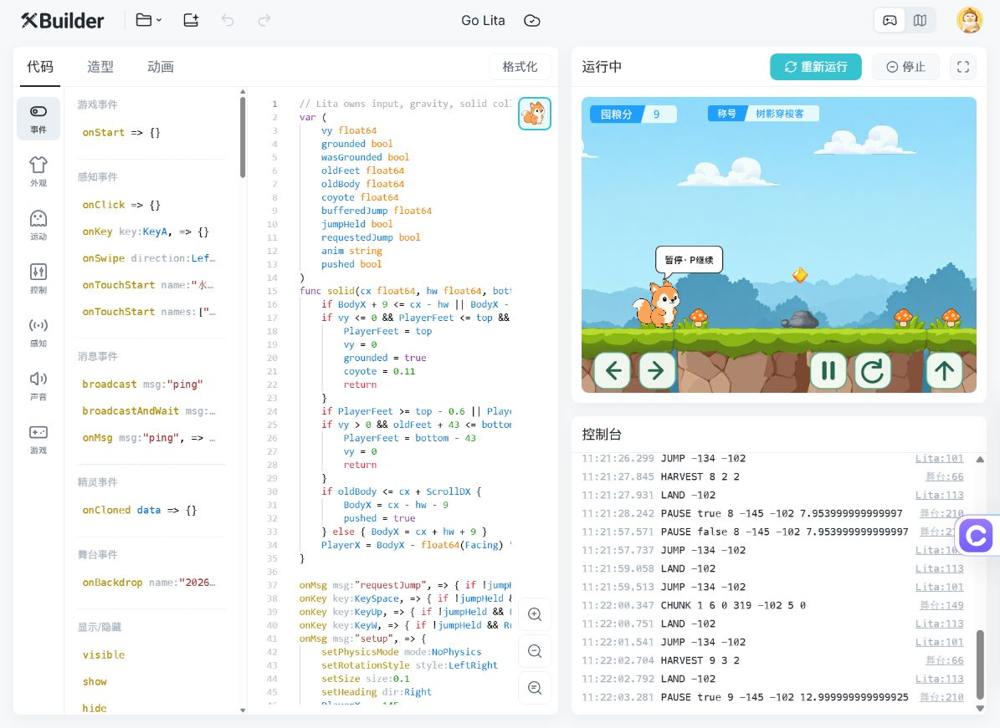
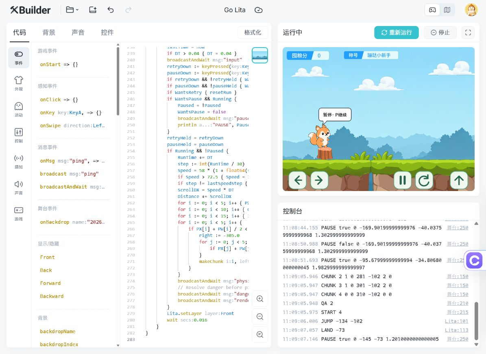
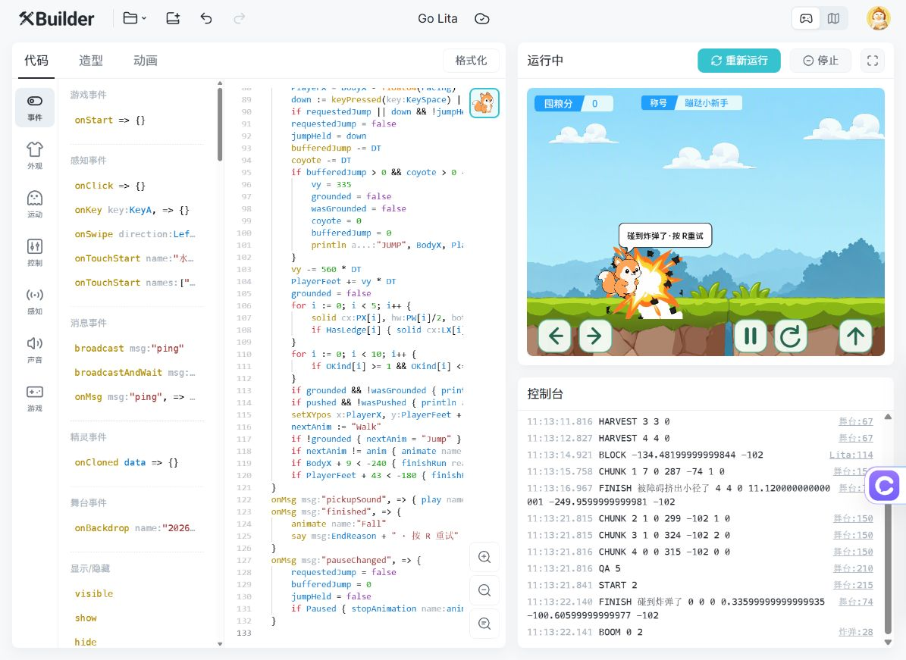

# Go Lita v0.3 验收记录

2026-10-25，账号 En / 项目 IdeaDash，XBuilder SPX 3.3.0 浏览器预览，480 × 360。使用实际键鼠输入、可见画面和页面控制台验证；没有发布。

## 验证方式

先在正式随机地图试玩，再临时替换地形布局进行可重复的单项检查。固定布局只改变对象摆放，使用相同的 Lita、实体、火焰、炸弹代码；测试后已恢复正式随机地图、重载云端、重新运行和导出。最终包没有 QA 快捷键或测试布局。

`tools/create_playtest_project.py` 可重建相同固定布局。固定布局结果不能代表所有随机组合都已穷举。

## 实测结果

| 项目 | 结果与证据 |
|---|---|
| XGo/SPX 编译 | 新版通过实际预览编译；修正了脚本函数须放在事件前的声明顺序 |
| 首次键盘输入 | 点击运行后未再点击或用测试工具聚焦 canvas，`pressKey(null, space)` 成功出现 JUMP；云端重载后的第一下空格同样成功，记录 `JUMP -134 -102`。已修正初始 held 状态；未修改 XBuilder 外层页面 |
| 快速重试后跳跃 | 正式地图 START 2 后第一下空格出现一次 JUMP，长按 1.3 秒后 LAND -102，没有自动连跳 |
| 控件删除 | 正式画面与舞台索引只保留积分、称号，顶部 Hint 监视器已删除；底部五个操作按钮保留 |
| 石头阻挡 | 正式地图 BLOCK 后继续运行约 2 秒，直到身体完全越界才 FINISH；一局结束 BodyX=-249.806，身体右侧小于 -240，接触当帧未结束 |
| 接触后脱困 | 固定石头场景：按右产生 BLOCK，随后 JUMP -156.002 -102，暂停时仍 Running，之后可向右跃过障碍；没有接触即失败 |
| 树桩顶部 | 从地面 -102 单跳后 LAND -73，停在树桩顶部，未结束 |
| 乱石堆顶部 | 单跳后 LAND -65，停在乱石堆顶部；新增资源已实际参与玩法 |
| 草地侧壁 | 28 像素台阶侧面先产生 BLOCK，跳起后 LAND -74；未从侧面吸到顶部 |
| 悬浮草台 | 起跳后 LAND -18，角色完整显示在草台前层；见截图 |
| 火焰结束 | 固定场景 FINISH 碰到火焰了，0.938 秒、0 分；接触身体即结束 |
| 炸弹单次爆炸 | FINISH 碰到炸弹了后仅一条 BOOM；可见 32 帧动画的爆炸中间帧。修正 render 重置动画的问题；结束立即冻结地图和分数 |
| 爆炸中重试 | BOOM 后约 0.4 秒重试，START 新局；画面恢复默认炸弹、角色初始位置与零分，旧克隆和爆炸不残留 |
| 无支撑下落 | 固定无支撑场景，脚底从 -102 持续下落，到 -226.009 时身体顶部已小于 -180，FINISH 掉进林间缺口了 |
| 纯收集计分 | 正式地图 `HARVEST 3 0 1` 验证首颗水晶 +3；随后 `HARVEST 8 2 2`、`HARVEST 9 3 2` 与公式一致；暂停间隔无收获变化 |
| 暂停与恢复 | 多次 PAUSE true/false 的分数、位置和 RunTime 保持一致；空中恢复后继续原跳跃，落在实体或地面 |
| 地形池循环 | 正式地图运行约 17 秒，出现多个离屏回收 CHUNK，日志覆盖普通补给、悬浮草台、43 像素缺口、火焰分路和炸弹模板；这些模板的单项碰撞另以固定布局验证 |
| 云端保存 | 导入正式工程后重载原 En/IdeaDash URL，新增精灵、脚本、删除的控件仍保持，重新运行成功；正式工程已导出 |

日志摘录：[qa-log.txt](evidence/qa-log.txt)。此前 v0.2 的加速和操作记录保留在 Git 历史中；本版新障碍与碰撞以本表为准。

## 画面证据

正式随机地图，收获 9 分，前方石头与上方水晶：

固定布局，Lita 落在树桩顶部：

炸弹接触后的爆炸中间帧，分数和地图已冻结：

另存 `rock-top.jpg`、`step-top.jpg`、`ledge-top.jpg`、`fall.jpg`，分别记录乱石堆、台阶、草台与掉落结果。

## 工程检查与范围

完整工程 24 个精灵、25 份 SPX 脚本、137 个文件。打包工具检查背景/造型/声音路径、动画首尾帧、精灵与声音 ID/顺序、删除的 Hint 控件、测试布局未混入、压缩包无重复/损坏项以及全部文件与源码逐字节一致。SPX 脚本统一 LF，检查 Git 行末空白。

首次按键在当前桌面内置浏览器通过；本轮没有对所有外部浏览器、窗口切换或其他设备焦点行为作专项测试。没有穷举随机地图、十分钟以上连续运行、手机多点触控、弱设备帧率或内存仪表长测。随机模板出现不等于每种组合都已完整通关。

界面仍为运行中的收集跑酷与场内重试；独立开始、介绍和结算页、美术最终替换留待后续。游戏未发布，两条 PR 均不合并。
